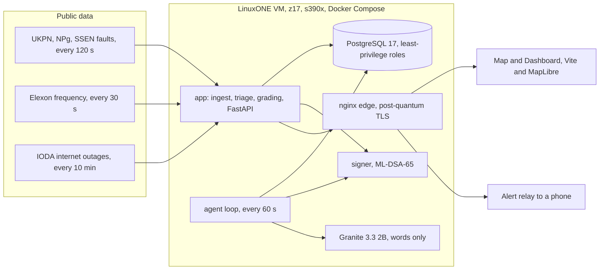
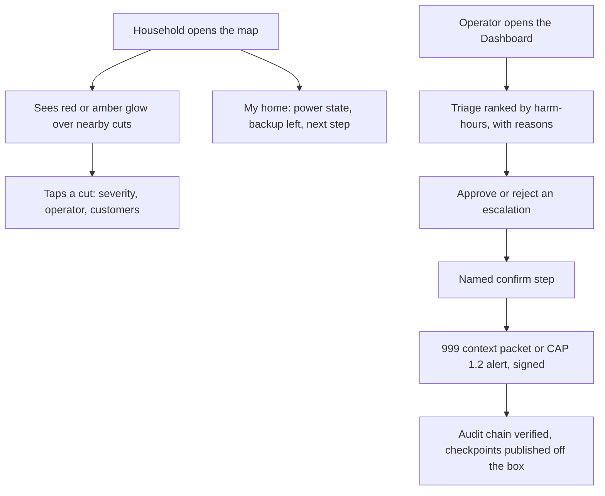

# Blacknaught

**Predict blackouts before they happen, and protect the people they'd hurt most.**

Blacknaught reads live UK grid fault feeds and home power sensors, shows where power is failing or likely to fail, and
works out which electricity-dependent patients will run out of backup before the lights come back. Then it tells the
people who can help, with a person signing off anything that reaches 999 or the public. It all runs on IBM LinuxONE
(s390x).

**Live demo:** <https://148-100-78-95.sslip.io:8443> · built in 24 hours by **The 4 Musketeers** for the IBM Z
Datathon 2026 (Manchester hub), Theme 1 (Real-Time AI for Critical Decisions) with Theme 2 security built in.

## Why

A static oxygen concentrator has no battery. A cylinder lasts roughly 8 to 20 hours, a ventilator battery 6 to 15.
Outage maps say a street is off; the Priority Services Register says someone vulnerable lives there. Nobody joins the
two and asks: *will this outage outlast this person's backup?* After Storm Arwen some homes were off for up to 11
days, and Ofgem found most people on the register couldn't recall being contacted.

## What it does

- **Map for everyone.** A live map of GB power cuts with a red (severe) or amber (moderate) glow over each one, a
  plain-word label on hover or tap, and "My home" for a household's own reserve clock and next step. Readable on a
  tablet; never shows a home or an ETA.
- **Dashboard for operators.** Forecasts, a ranked triage list, the agent's decisions, audit verification and charts.
  Approving a 999 escalation or a public alert needs the operator login and a named confirm step.
- **Predicts** at three honest horizons: district fault risk for tomorrow, homes likely to lose power in the next 30
  minutes (from fuse-box sensors), and grid-wide stress in seconds (from frequency).
- **Protects.** For every enrolled patient in a cut, compares the likely remaining outage with their remaining backup
  and ranks people by expected harm-hours, with a plain-English reason.
- **Acts, with guardrails.** An agent plans visits, texts carers and drafts CAP 1.2 alerts; every tool call is signed
  (ML-DSA-65) and logged in a tamper-evident audit chain.
- **Grades itself** every 15 minutes against the operators' real restore times.

## How it works

### System



### People



How cautious triage is depends on what's at stake. It uses the 90th percentile of remaining outage time for a patient
with no second power source and under 2 h of reserve, the median when reserve is over twice the median, and the 75th
percentile otherwise. A "power back" SMS never de-escalates a patient with no backup. A fault that just disappears from
a feed is treated as censored, not restored, so the grades mean something.

## Tech stack

| Layer | Choice | Why |
|---|---|---|
| Base image | IBM `jupyterlab-image-s390x` (Python 3.12, TensorFlow + zDNN, XGBoost, pandas) | IBM's compiled s390x stack, pinned so pip can't replace it |
| API | FastAPI, uvicorn, sse-starlette | Async and pure Python, so no s390x wheel gaps |
| Database | PostgreSQL 17 via pg8000 | psycopg2 has no s390x wheel; roles and views give least privilege |
| Crypto | AES-256-GCM via libcrypto (`ctypes`, uses CPACF), argon2id sessions, ML-DSA-65 signer (OpenSSL 3.5) | `cryptography` isn't available on s390x |
| Edge | nginx 1.26.3 on Debian trixie, OpenSSL 3.5.7 | Offers the X25519MLKEM768 hybrid post-quantum key exchange |
| Agent text | IBM Granite 3.3 2B Instruct, big-endian Q4_K_M, via `llama_cpp` | On the box, no cloud AI; it only words decisions |
| Alerts | CAP 1.2 XML, XSD-validated in tests | The OASIS standard for public warnings |
| Frontend | Vite, TypeScript, MapLibre GL JS | Built on a laptop, served as static files |
| Tests | pytest, pytest-cov, xmlschema; Vitest | Backend runs on the VM against a separate test database |

### Why LinuxONE

- **Trained on the box:** duration and district-risk models are fitted on the VM from raw operator data
  (`evidence/03_training.txt`, `notebooks/train_on_linuxone.ipynb`).
- **Big-endian safe:** XGBoost JSON and `.keras` only, never pickles, with predictions checked on s390x.
- **Hardware crypto:** patient fields are AES-256-GCM through libcrypto on CPACF, tested against NIST vectors.
- **Telum NNPA does real work:** Nate's trained Keras duration model (M2) scores every at-risk patient and outage on it
  each minute, in shadow; the zDNN log shows the matmuls and softmax going to the NNPA. It's signed, refused if
  tampered with, and graded beside the live Kaplan–Meier curve. NNPA on vs off is timed in `evidence/nnpa_timing.csv`.
- **Security a regulator would expect:** least-privilege roles, hash-chained and signed audit, post-quantum TLS
  (`evidence/09_edge_pq_tls.txt`), and nothing under a count of 11 shown on a map.

## Results

Numbers from the VM on 18 Oct 2026. Lower Brier is better; always guessing 50% scores 0.25.

| What | Result |
|---|---|
| Live grading, UKPN (explicit restore times) | Brier 0.165 at +2 h over 283 outages, 0.156 at +4 h over 205 |
| Duration models, UKPN's newest year | Kaplan–Meier refitted on UKPN 0.1297 vs ENWL curve 0.1311 (live now); XGBoost AFT 0.149 and Keras hazard 0.141 on UKPN, so they stay offline |
| Weather fault risk (M8), 2024–26 | Brier 0.199 vs baseline 0.210, +5.1% skill; Storm Éowyn: M8 expected 27 faults, baseline 7.6 (actual 226) |
| Grid stress replay, 9 Aug 2019 | 74 s of warning before demand disconnection; M4 rule 0.4 false alarms a month vs 11.1 for the 49.8 Hz band |
| Home-sensor warning, real Accra data | Flags 0.96% of home-windows; 18.8% ± 1.1% lose power within 30 min, 8.9× the 2.1% base rate (ROC AUC 0.666) |
| Low voltage alone | ROC AUC 0.514, close to a coin flip, so it's not in the pitch |
| Tests | 237 backend tests on s390x (96% coverage), 141 frontend tests (92%) |

Details: `evidence/`, `ml/notebooks/`, `evidence/train_log_*.txt`.

## Run it on LinuxONE

You need an s390x host with Docker and Compose (the IBM LinuxONE Community Cloud works). **No LinuxONE access?** Use
the [live demo](https://148-100-78-95.sslip.io:8443), the video and the deck; everything below is what runs there.

```bash
git clone https://github.com/saliha006/BlackNaught.git && cd BlackNaught

# 1. Secrets are files, never environment variables
mkdir -m 700 secrets
for s in pg_super_pw db_migrator_pw db_ingest_pw db_api_pw db_agent_pw bidx_key dek operator_pw; do
  openssl rand -hex 32 > secrets/$s
done
sudo docker compose -f infra/docker-compose.yml build signer
bash scripts/make-signer-secrets.sh   # ML-DSA-65 key + per-caller tokens; run as a docker-group user, not sudo
bash scripts/make-edge-cert.sh        # a self-signed edge certificate until a trusted one replaces it

# 2. Granite (pinned by SHA-256 in infra/granite.yml)
mkdir -p ../models && curl -L -o ../models/granite-3.3-2b-instruct-be.Q4_K_M.gguf \
  https://huggingface.co/taronaeo/Granite-3.3-2B-Instruct-BE-GGUF/resolve/main/granite-3.3-2b-instruct-be.Q4_K_M.gguf

# 3. The stack: db, app, signer, agent, Granite, edge
sudo docker compose -f infra/docker-compose.yml up -d --build
C="sudo docker compose -f infra/docker-compose.yml exec app"
$C python -m app.migrate
$C python -m app.auth bootstrap                      # operator login (password in secrets/operator_pw)
$C python -m app.seed --households 3                 # synthetic patients on live faults + 3 household logins
curl -s localhost:8000/api/health
```

Optional, for the two-houses demo: pick a fresh fault from `/api/outages` and run
`$C python -m app.seed --per-outage 0 --two-houses <outage_id>`. Household passphrases land in
`backend/secrets/households.txt`.

**Frontend** (build on a laptop, never on the VM):

```bash
cd frontend && npm ci && npm run build
rsync -a --delete dist/ <user>@<host>:~/BlackNaught/frontend/dist/   # copy into the folder nginx mounts
```

Then open `https://<host>:8443`. API docs are at `/api/docs`; the API itself binds to `127.0.0.1` and the edge is the
only public entry point.

**Tests and proof:**

```bash
sudo docker compose -f backend/compose.backend.yml run --rm --no-deps app pytest --cov=app   # backend, on s390x
cd frontend && npm test                                                                      # frontend
bash infra/test-compose.sh   # checks network and port boundaries in the rendered Compose config
bash scripts/proof.sh        # reruns the evidence pack into evidence/, never prints a secret
```

Python packages: [`requirements.txt`](requirements.txt) lists only what's installed on top of IBM's image.

## Repo layout

| Path | What's there |
|---|---|
| `backend/` | FastAPI app, ingest, triage, grading, audit, agent; tests |
| `frontend/` | Map and Dashboard (Vite, TypeScript, MapLibre) |
| `infra/` | Production Compose stack, nginx edge, signer and Granite services |
| `signer/`, `alerting/`, `offbox/` | ML-DSA signer, phone alert relay, off-box audit checkpoint publisher |
| `ml/` | Duration, home-sensor, weather-risk and grid-stress models |
| `db/` | Roles and forward-only migrations |
| `contracts/` | Frozen OpenAPI, event schema, model and signer contracts |
| `evidence/` | Proof that it runs and trains on LinuxONE |

## Data and licences

| Dataset | Used for | Licence |
|---|---|---|
| ENWL historic unplanned outages (312,936, 2000–2026) | Training duration and district risk | CC BY 4.0 |
| UKPN Interruptions Incentive Scheme (180,059 incidents) | Cross-operator validation, live curve | CC BY 4.0 |
| UKPN, Northern Powergrid, SSEN live faults | Live outages and grading | CC BY 4.0, NPg Open Data Licence v1.0, public feed |
| Elexon and NESO system frequency | Grid stress, live and replay | Public API, NESO Open Data Licence |
| IODA (Georgia Tech) | Wide-area outage signal | Free for research |
| Open-Meteo | Weather for M8 | CC BY 4.0 |
| postcodes.io | Postcode lookups | Open Government Licence |
| nLine GridWatch Accra | Home-sensor study and replay | CC BY-NC 4.0, GPS and IDs stripped first |

There is no real patient data anywhere. Every patient is synthetic (`backend/app/seed.py`), placed on real fault
footprints, with phone numbers from Ofcom's drama range; a table constraint refuses non-synthetic rows.

## What went wrong, and what we changed

- Northern Powergrid labels UK local time as UTC; we parse it as UK wall-clock.
- UKPN uses `0001-01-01` for "not known yet"; it was being read as a restore time.
- Elexon once published 182 readings of 0 Hz; out-of-range readings are now dropped.
- ENWL redrew its districts in mid-2024, which made Penrith and Workington look about 10× too safe; area risk now
  averages each district only over months it existed.
- Trained duration models lost to a simple curve on another operator's data, so the simple curve is what runs live.

## Limits and next steps

- Patients and the GB home sensors are simulated; faults, restore times, frequency and the Accra data are real.
- Live area risk is still the climatology baseline (labelled BASELINE); the weather model beats it but isn't wired in.
- Northern Powergrid can't be graded and SSEN only partly, because grading needs explicit restore times.
- Grid stress gives seconds of warning, and only on 1-second data; Elexon's live feed is 15 s and about 1.5 min late.
- Granite takes about 80 s per text on the CPU, so the agent keeps its template for most ticks. M2 runs on the
  NNPA in shadow only: it's graded, but the live ranking is the Kaplan–Meier curve, which scored better on UKPN.
- The public alert goes to a phone over ADB, standing in for a government channel; nothing is broadcast.
- The evidence combiner (`backend/app/combiner.py`) fuses sensor quorum, the DNO feeds, IODA and grid stress into one
  outage probability per cell, scored on live footprints in `evidence/localiser.json`. Triage doesn't use it yet, and
  its likelihood ratios are hand-set, because the measured table never arrived.
- Not done yet: a LUKS2-encrypted database volume and a signer-wrapped field key. Jupyter (port 38888) is open behind
  its token for the event; a real deployment would close it.
- Next: a pilot with one health team and one network operator, a small real sensor fleet whose data becomes local
  outage labels, and a learned combined risk score once one grid has all three data types.

## Team

| Who | GitHub | Built |
|---|---|---|
| Sali | `saliha006` | Backend (ingest, schema and roles, triage, grading, audit, auth, SSE, CAP, my home, encryption), sensor probe, evidence scripts; frontend Dashboard and map-first redesign |
| Ahmed | `meep-boop` | Platform: VM and Compose stack, post-quantum edge, ML-DSA signer, agent loop, Granite, sensor simulator, Accra replay, alert relay, IBM labs |
| Nate | `aldrichbanas07` | Data and ML: survival models, home-sensor model, weather area risk, grid stress validation, s390x ML checks |
| Rama | `rama0623` | Frontend: landing page, map, two-houses card, charts, video |

## Open source

FastAPI, Starlette, Pydantic, uvicorn, sse-starlette, pg8000 (with scramp and asn1crypto), httpx, anyio, argon2-cffi,
PyYAML, PostgreSQL, OpenSSL, Docker, nginx, TensorFlow and the IBM zDNN plugin, XGBoost, NumPy, pandas, scikit-learn,
llama.cpp, JupyterLab, pytest, pytest-cov, coverage.py, xmlschema, Vite, TypeScript, Vitest, MapLibre GL JS, IBM Plex.

nLine GridWatch data is used under CC BY-NC 4.0, and this project is non-commercial.
