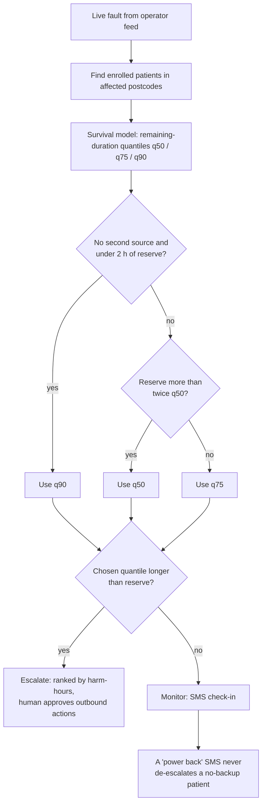
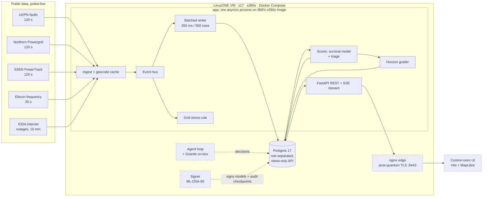
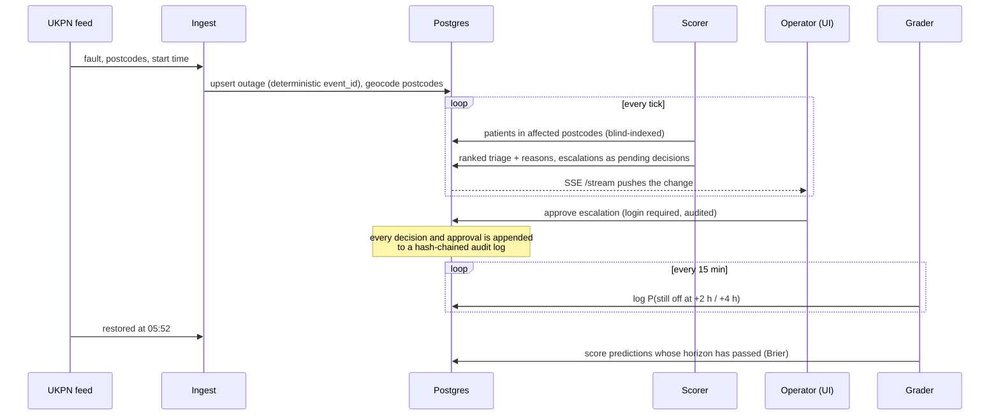

# Blacknaught

Blacknaught predicts blackouts before they happen and protects the people they'd hurt most.

It watches live grid fault feeds and home power sensors, flags where power is likely to fail, and when it does fail,
works out which electricity-dependent patients will run out of backup before the lights come back. Then it tells
the people who can help them. Everything runs on an IBM LinuxONE (s390x) VM.

Built in 24 hours by **The 4 Musketeers** for the IBM Z Datathon 2026 (Manchester hub, Theme 1: Real-Time AI for
Critical Decisions, with Theme 2 security built in).

---

## The problem

A static oxygen concentrator has no battery. When the mains goes, it stops. A cylinder buys somewhere between 8 and
20 hours depending on flow rate. A modern ventilator battery lasts about 15 hours, an older one about 6.

Outage maps tell you a street is off. The Priority Services Register tells you someone vulnerable lives there.
Restoration estimates guess when power comes back. Nothing joins those three up and asks the obvious question:
**will this outage last longer than this person's backup?** That's the question Blacknaught answers, for every
enrolled patient, every minute, and it ranks people by how badly the answer could go wrong.

After Storm Arwen (2021) some households were without power for up to 11 days, and Ofgem found most people on the
register couldn't recall being contacted. A 2026 coroner's report described a power-dependent man who rang 999 during a
cut and got a Category 2 response, because the system "cannot tell that a caller's medical devices have lost power".

## What it does

Two halves: **predict** where power will fail, then **protect** the people it will hurt.

| Layer | Question it answers | Honest lead time | State |
|---|---|---|---|
| Area fault risk | Which districts are likely to have faults tomorrow? | Hours to days | Live: climatology baseline from 30 years of ENWL faults. Weather-driven model in progress |
| Home sensors | Which homes are most likely to lose power in the next 30 minutes? | Minutes | Validated on real sensor data from Accra (results below). Served model in progress |
| Grid stress | Is the whole grid heading for trouble? | Seconds | Live from Elexon frequency |
| **Protect** | Who runs out of backup first, and who do we call? | During the cut | Live: triage, horizon grading, approvals, CAP alerts, "my home" view |

We're careful about what "predict" means here. We don't claim to predict every blackout, and we don't claim
frequency gives minutes of warning (it gives seconds, and it can't tell you *where*). Each layer is shown with its own
source and horizon rather than blended into one magic percentage.

### Triage, in one paragraph

For each patient caught in an outage we estimate how much longer the outage will run, using a survival model trained
on 312,936 real outages. We compare a quantile of that remaining time against the patient's remaining backup. Which
quantile depends on how much is at stake: a patient with no second power source and under two hours of reserve gets the
pessimistic 90th percentile, someone with plenty of headroom gets the median, everyone else the 75th. Patients are
ranked by expected harm-hours (severity × chance there's no other backup × expected hours past their reserve), and
anyone whose chosen quantile beats their reserve is escalated. Every ranking carries a plain-English "why".



### It grades itself

A model that's never checked is a guess. Every 15 minutes the backend logs, for each live outage, the probability that
it will still be off 2 and 4 hours later. When those horizons pass, it checks the operator's own feed and scores the
prediction with a Brier score. Outages that vanish from a feed without an explicit restore time are *censored*, not
counted as restored, and we report the best and worst case those censored rows could have produced.

## Architecture



Dashed boxes are being built by teammates as this is written; the rest is running on the VM now.

A few decisions that shaped this:

- **One process, not microservices.** Ingest, scoring, grading and the API share one asyncio event loop. On 3 vCPUs
  and 8 GB, an extra network hop per event buys nothing. The writer batches inserts (250 ms or 500 rows, whichever
  comes first) so the database sees a few large transactions instead of thousands of small ones.
- **The API can only read views.** Postgres has four login roles (`bn_migrator`, `bn_ingest`, `bn_api`, `bn_agent`),
  each granted the minimum. The API role can't touch base tables, so a bug in a handler can't leak an encrypted column
  or write anything it shouldn't.
- **A dropped record isn't a restored record.** Feeds silently remove faults. If we treated that as "power's back" our
  grades would look great and mean nothing. Records missing for two polls are marked *vanished*, and grading treats
  them as censored.
- **Contracts first.** `contracts/openapi.yaml`, `contracts/events.schema.json` and `contracts/model.md` were frozen
  before the frontend and ML work started, so four people could build in parallel against fixtures.

### What happens to one outage



## Why LinuxONE

This isn't a project that happens to run on Z. The platform is doing real work:

- **Training happens on the VM.** The duration model and the district risk model are fitted on the s390x box from
  raw operator data downloaded straight onto it (`evidence/03_training.txt`). The notebook
  `notebooks/train_on_linuxone.ipynb` reruns it in IBM's Jupyter image.
- **The models are big-endian safe.** We save XGBoost JSON and `.keras` files, never pickles, and check that
  predictions round-trip identically on s390x (`evidence/08_ml_stack_checks.txt` on the `nate-ml` branch).
- **Encryption uses the hardware.** Patient fields are AES-256-GCM encrypted through the system libcrypto, which uses
  CPACF on Z. We call it through `ctypes` because the `cryptography` wheel doesn't exist for s390x, and we test it
  against the NIST vectors.
- **Telum's on-chip AI accelerator (NNPA)** is present on the VM and the zDNN TensorFlow plugin loads. The served
  Keras duration model is meant to score every at-risk patient × outage as one batch per tick on it.
- **Security that a regulated operator would expect:** least-privilege roles, a tamper-evident audit chain,
  argon2id operator sessions, encrypted fields with a blind index for lookups, and a k≥11 suppression rule on anything
  shown on a map.

## Results so far

All numbers below came from the VM on the morning of 18 Oct 2026.

**Live grading of the Kaplan–Meier baseline** against real restorations (lower Brier is better; always saying 50%
scores 0.25):

| Operator | Horizon | Graded | Censored | Brier | Possible range with censored rows |
|---|---|---|---|---|---|
| UKPN | +2 h | 283 | 3 | 0.165 | 0.165 – 0.168 |
| UKPN | +4 h | 205 | 0 | 0.156 | 0.156 |
| SSEN | +2 h | 21 | 70 | 0.099 | 0.090 – 0.410 |
| SSEN | +4 h | 10 | 64 | 0.279 | 0.229 – 0.285 |
| Northern Powergrid | both | 0 | 483 | — | NPg doesn't publish restore times, so nothing can be graded |

UKPN is the number to trust: it publishes explicit restore times, so almost nothing is censored. SSEN's restore times
are approximate and most rows end up censored, which is why its range is so wide. This is the baseline the trained
survival model has to beat.

**Home-sensor early warning, tested on real data.** We took one week of nLine GridWatch readings from 429 plug-in
sensors in Accra, Ghana (4.76 M readings, June 2021), trained on five days and tested on the next two. The label:
did this home lose power within 30 minutes?

| Signal | ROC AUC | Notes |
|---|---|---|
| Learned model on the home's own sensor | **0.668** | Top 1% of alerts were right 19.7% of the time, 9.3× the 2.1% base rate |
| + share of the district already dark | 0.684 | Small gain |
| Rule: recent flicker | 0.568 | |
| Rule: low voltage | 0.514 | Basically a coin flip |

The useful signals were supply instability and time of day. Low voltage on its own, which is what most people
(including us) assumed would work, barely beats chance. That's why the pitch says "flags homes at risk", not "predicts
every blackout". Full output: `evidence/07_precursor_probe.txt`.

**Engineering:** 198 tests pass on s390x with 96% line coverage (`evidence/04_tests.txt`). Five live sources were
healthy at the time of writing.

## Data

| Dataset | Used for | Licence |
|---|---|---|
| Electricity North West, historic unplanned outages (312,936 events, 2000–2026) | Training the duration and district risk models | CC BY 4.0 |
| UK Power Networks, Interruptions Incentive Scheme (316,435 rows, 180,059 incidents) | Cross-operator validation | CC BY 4.0 |
| UKPN live faults | Live outages, grading | CC BY 4.0 |
| Northern Powergrid live power cuts | Live outages | Open Data Licence v1.0 |
| SSEN PowerTrack | Live outages | Public feed, no key |
| Elexon system frequency | Grid stress | Public API, no key |
| IODA (Georgia Tech) | Wide-area internet outages as a blackout signal | Free for research |
| postcodes.io | Postcode to lat/long | Open Government Licence (ONS data) |
| nLine GridWatch Accra | Home-sensor early-warning study | **CC BY-NC 4.0**, non-commercial; GPS and IDs stripped before upload |
| Open-Meteo (ERA5 + forecast) | Weather features for area risk (in progress) | CC BY 4.0 |

**No real patient data exists anywhere in this system.** Every patient is synthetic, generated by `backend/app/seed.py`,
and placed on real fault footprints. Phone numbers come from Ofcom's range reserved for TV and film, so none can reach
a real person. The LinuxONE Community Cloud terms forbid real health data on the VM, and a table constraint enforces it.

## Tech stack

| Layer | Choice | Why |
|---|---|---|
| Base image | IBM `jupyterlab-image-s390x` (Python 3.12, TensorFlow + zDNN, XGBoost, pandas, scikit-learn) | IBM's compiled s390x stack. We pin it with a constraints file so pip can never replace it |
| API | FastAPI + uvicorn + sse-starlette | Async, typed, pure Python, so no s390x wheel problems |
| DB driver | pg8000 | psycopg2 has no s390x wheel. pg8000 is pure Python; we run one thread per connection |
| Database | PostgreSQL 17 | Roles, views and `SECURITY DEFINER` functions give us least privilege without extra services |
| Crypto | AES-256-GCM via libcrypto (`ctypes`) · argon2id sessions · ML-DSA-65 signer (in progress) | Uses CPACF; `cryptography` isn't available on s390x |
| Alerts | CAP 1.2 XML, built with ElementTree, XSD-validated in tests | The OASIS standard for public warnings, so an authority can push it to its own broadcast channel |
| Frontend | Vite + TypeScript + MapLibre GL (in progress) | Built on a laptop, served as static files, never run on the VM |
| Ops | Docker Compose, iptables, per-person SSH keys | |
| Tests | pytest, pytest-cov, httpx ASGI transport, xmlschema | Run inside the app container on the VM against a separate test database |

## Running it on LinuxONE

You need an s390x host with Docker and Compose. On our VM:

```bash
git clone https://github.com/saliha006/BlackNaught.git && cd BlackNaught

# secrets are files, never environment variables
mkdir -m 700 secrets
for s in pg_super_pw db_migrator_pw db_ingest_pw db_api_pw db_agent_pw bidx_key dek operator_pw; do
  openssl rand -hex 32 > secrets/$s
done

cd backend
sudo docker compose -f compose.backend.yml up -d --build
sudo docker compose -f compose.backend.yml exec app python -m app.migrate
sudo docker compose -f compose.backend.yml exec app python -m app.auth bootstrap    # operator login
sudo docker compose -f compose.backend.yml exec app python -m app.seed              # synthetic patients on live faults

curl -s localhost:8000/api/health
```

The API docs are at `/api/docs`. The API binds to `127.0.0.1` on purpose; the public entry point is the nginx edge.

Tests:

```bash
sudo docker compose -f compose.backend.yml run --rm --no-deps app pytest --cov=app
```

`scripts/proof.sh` reruns the whole evidence pack in one go: platform, containers, training, tests, live service,
security checks. It writes to `evidence/` and never prints a secret.

### Main endpoints

| Endpoint | What it gives you |
|---|---|
| `GET /api/outages` | Live outages across all operators, deduplicated |
| `GET /api/triage` | Ranked patients with remaining-time quantiles, harm-hours and reasons |
| `GET /api/agent/grades` | Brier scores by operator and horizon, plus an hourly trend |
| `GET /api/areas/risk` | District fault risk for a date |
| `GET /api/grids/{grid}/stress` | Grid stress state from live frequency |
| `GET /api/cells` | Map counts on fixed cells, with anything from 1 to 10 suppressed |
| `POST /api/decisions/{id}/approve` | Operator approves an escalation (login required) |
| `GET /api/alerts/cap/{id}` | The CAP 1.2 XML for an approved area alert |
| `GET /api/me/home` | A household's own view: power state, reserve clock, next step (login required) |
| `GET /api/audit/verify` | Walks the audit hash chain and reports the first broken link, if any |
| `GET /stream` | Server-sent events for everything above |

## Things that went wrong, and what we changed

- **Northern Powergrid sends UK local time labelled as UTC.** Outages looked an hour older than they were during
  British Summer Time. We now parse NPg times as UK wall-clock time.
- **UKPN uses `0001-01-01` as a "not known yet" date.** We were reading it as a real restore time. Those rows are now
  treated as unknown.
- **Everyone was escalated.** Our first synthetic register put patients on faults that had been running for days, so
  every reserve had already run out. Patients are now only seeded onto faults less than 6 hours old.
- **A killed Postgres connection crashed the poller.** pg8000 raises a plain `ConnectionResetError`, which our retry
  logic didn't recognise as a connection error. It does now.
- **The obvious sensor signal didn't work.** We expected low voltage to warn of an outage. On real data it scored
  0.514 AUC. We dropped it from the pitch rather than quietly keep it.
- **Elexon published 182 readings of 0 Hz** on 6 Aug 2026. Our stress rule would read that as a grid emergency.
  Nate caught it in the historical data before it could fake an emergency in a demo; impossible readings have to be
  dropped before they reach the stress rule.

## Known limits

- Patients and the home sensors on GB faults are simulated. The fault data, restore times, frequency and the Accra
  sensor data are real.
- The duration model running live right now is the Kaplan–Meier baseline. The trained gradient-boosted survival model
  replaces it behind the same interface.
- Area risk is a climatology baseline and is labelled as one in the API. It flags about 39% of district-days, which is
  too blunt to act on alone. The weather model is meant to fix that.
- Grading needs explicit restore times, so Northern Powergrid can't be graded and SSEN only partly.
- GB is the proving ground. Ghana (where the sensor data comes from) and Sri Lanka are the first target grids, and
  adding one needs local outage labels, a data agreement and a health partner, not just a config file.

## Team

| Who | GitHub | Built |
|---|---|---|
| Sali | `saliha006` | Backend: ingest, schema and roles, triage, grading, audit chain, auth and approvals, SSE, map cells, CAP export, "my home", encryption, the home-sensor probe, evidence scripts |
| Ahmed | `meep-boop` | Platform: VM, edge with post-quantum TLS, model signer, agent loop, sensor simulator and Accra replay, IBM labs |
| Nate | `aldrichbanas07` | Data and ML: survival model, home-sensor model, weather-driven area risk, grid stress validation, ML stack checks on s390x |
| Rama | `rama0623` | Frontend: control-room UI, map, triage and approval views, video |

## What we'd do next

- Pilot with one district health team and one network operator, with real consent at hospital discharge.
- Replace simulated sensors with a small fleet of fuse-box sensors and use their data as local outage labels.
- Learn a combined risk score once a single grid has all three data types (area history, home sensors, frequency).
- Publish audit checkpoints off the box so tampering is detectable by someone other than us.

## Open-source software

FastAPI, Starlette, Pydantic, uvicorn, sse-starlette, pg8000 (with scramp and asn1crypto), httpx, anyio, argon2-cffi,
PyYAML, PostgreSQL, OpenSSL, Docker, nginx, TensorFlow and the IBM zDNN plugin, XGBoost, NumPy, pandas, scikit-learn,
JupyterLab, pytest, pytest-cov, coverage.py, xmlschema, Vite, TypeScript, MapLibre GL JS.

Data credits are in the [Data](#data) table above. nLine GridWatch data is used under CC BY-NC 4.0 and this project is
non-commercial.
