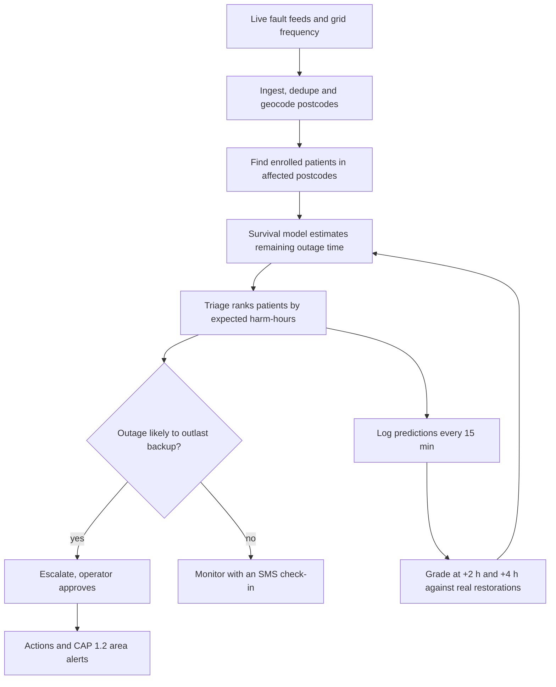
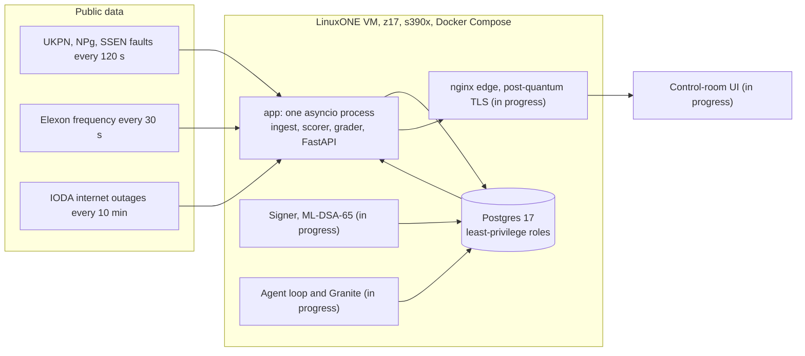

# Blacknaught

Blacknaught predicts blackouts before they happen and protects the people they'd hurt most.

It reads live grid fault feeds and home power sensors, flags where power is likely to fail, and when it does fail,
works out which electricity-dependent patients will run out of backup before the power comes back. Then it tells the
people who can help. It all runs on an IBM LinuxONE (s390x) VM.

Built in 24 hours by **The 4 Musketeers** for the IBM Z Datathon 2026 (Manchester hub). Theme 1, Real-Time AI for
Critical Decisions, with Theme 2 security built in.

## Why this exists

A static oxygen concentrator has no battery. A cylinder lasts roughly 8 to 20 hours, a modern ventilator battery about
15, an older one about 6. Outage maps say a street is off. The Priority Services Register says someone vulnerable lives
there. Nobody joins the two and asks: will this outage outlast this person's backup? After Storm Arwen some homes were
off for up to 11 days, and Ofgem found most people on the register couldn't recall being contacted.

## What it does

Two halves: predict where power will fail, then protect the people it will hurt.

| Layer | Question | Lead time | State |
|---|---|---|---|
| Area fault risk | Which districts are likely to have faults tomorrow? | Hours to days | Live climatology baseline. Weather model in progress |
| Home sensors | Which homes will probably lose power in the next 30 minutes? | Minutes | Tested on real Accra sensor data. Served model in progress |
| Grid stress | Is the whole grid in trouble? | Seconds | Live, from Elexon frequency |
| Protect | Who runs out of backup first, and who do we call? | During the cut | Live: triage, grading, approvals, CAP alerts, "my home" |

Each layer keeps its own source and horizon. We don't blend them into one made-up percentage. For households,
`/api/me/home` is getting a headline risk level (Low / Elevated / High) with the three layer gauges underneath, each
labelled with where it came from. That part is being built now.

We don't claim to predict every blackout, and frequency only gives seconds of warning. It can't tell you where.

## How it works



Triage compares a quantile of the remaining outage time with the patient's remaining backup. How cautious it is depends
on what's at stake:

| Patient | Quantile used |
|---|---|
| No second power source and under 2 h of reserve | 90th percentile, the pessimistic one |
| Reserve more than twice the median | Median |
| Everyone else | 75th percentile |

Patients are ranked by severity, times the chance they have no other backup, times the expected hours past their
reserve. Every ranking comes with a plain-English reason. A "power back" SMS never de-escalates a patient with no
backup.

The system also grades itself. Every 15 minutes it logs, for each live outage, the chance it's still off 2 and 4 hours
later, then scores that against the operator's own restore time. A fault that just disappears from a feed is treated as
censored, not restored.

## Architecture



Some choices worth knowing:

- **One process.** Ingest, scoring, grading and the API share one asyncio loop. On 3 vCPUs and 8 GB, splitting them
  would add network hops and buy nothing. Writes are batched (250 ms or 500 rows).
- **The API can only read views.** Four Postgres login roles, each with the minimum it needs. A bug in a handler can't
  reach base tables or encrypted columns.
- **A missing record isn't a restored one.** Feeds silently drop faults. Records gone for two polls are marked
  "vanished" and graded as censored, so our scores mean something.
- **Contracts first.** `contracts/openapi.yaml`, `contracts/events.schema.json` and `contracts/model.md` were frozen
  early so four people could build in parallel.

## Tech stack

| Layer | Choice | Why |
|---|---|---|
| Base image | IBM `jupyterlab-image-s390x` (Python 3.12, TensorFlow + zDNN, XGBoost, pandas) | IBM's compiled s390x stack, pinned so pip can't replace it |
| API | FastAPI, uvicorn, sse-starlette | Async and pure Python, so no wheel problems |
| DB driver | pg8000 | psycopg2 has no s390x wheel |
| Database | PostgreSQL 17 | Roles, views and `SECURITY DEFINER` give least privilege with no extra services |
| Crypto | AES-256-GCM via libcrypto (`ctypes`), argon2id sessions, ML-DSA-65 signer (in progress) | Uses CPACF. `cryptography` isn't available on s390x |
| Alerts | CAP 1.2 XML, XSD-validated in tests | The OASIS standard for public warnings |
| Frontend | Vite, TypeScript, MapLibre GL (in progress) | Built on a laptop, served as static files |
| Tests | pytest, pytest-cov, httpx, xmlschema | Run on the VM against a separate test database |

## Why LinuxONE

- **We train on it.** The duration and district risk models are fitted on the VM from raw operator data downloaded
  straight onto it (`evidence/03_training.txt`, `notebooks/train_on_linuxone.ipynb`).
- **Models are big-endian safe.** XGBoost JSON and `.keras` only, never pickles, with predictions checked to match on
  s390x.
- **Encryption uses the hardware.** Patient fields are AES-256-GCM through the system libcrypto, which uses CPACF,
  tested against NIST vectors.
- **Telum's NNPA is there.** The zDNN TensorFlow plugin loads on the VM. The served Keras duration model is meant to
  score every at-risk patient and outage as one batch per tick on it.
- **Security a regulator would expect.** Least-privilege roles, a hash-chained audit log, operator login for approvals,
  a blind index for encrypted lookups, and nothing under a count of 11 shown on a map.

## Results so far

Numbers from the VM on the morning of 18 Oct 2026.

**Live grading of the Kaplan–Meier baseline** against real restorations. Lower Brier is better; always guessing 50%
scores 0.25.

| Operator | Horizon | Graded | Censored | Brier | Range if censored rows went either way |
|---|---|---|---|---|---|
| UKPN | +2 h | 283 | 3 | 0.165 | 0.165 to 0.168 |
| UKPN | +4 h | 205 | 0 | 0.156 | 0.156 |
| SSEN | +2 h | 21 | 70 | 0.099 | 0.090 to 0.410 |
| SSEN | +4 h | 10 | 64 | 0.279 | 0.229 to 0.285 |
| Northern Powergrid | both | 0 | 483 | n/a | No restore times published |

UKPN is the one to trust, because it publishes explicit restore times. This is the baseline the trained survival model
has to beat.

**Trained duration models (M2), offline test.** Trained on the VM on ENWL 2000–22 (269,170 outages), tested on ENWL
2024–26 and on 178,864 UKPN outages none of the models saw (`ml/notebooks/m2_duration.ipynb`). Integrated Brier over the
first 24 hours; lower is better:

| Model | ENWL 2024–26 | UKPN |
|---|---|---|
| Kaplan–Meier (live today) | 0.121 | 0.138 |
| Kaplan–Meier per cause (cause isn't known live) | 0.109 | n/a |
| XGBoost AFT on live fields | 0.114 | 0.149 |
| Keras hazard MLP on live fields | 0.117 | 0.141 |

Start time, customers and voltage carry little signal. The fault's cause carries the most, and the live feeds don't
publish it. Trained on one operator, the models don't beat Kaplan–Meier on another, so they aren't live.

**Home-sensor early warning on real data.** One week of nLine GridWatch readings from 429 sensors in Accra, Ghana
(4.76 M readings, June 2021). Trained on five days, tested on the next two. Label: did this home lose power within 30
minutes?

| Signal | ROC AUC |
|---|---|
| Learned model on the home's own sensor | 0.668. Top 1% of alerts were right 19.7% of the time, 9.3x the 2.1% base rate |
| Plus the share of the district already dark | 0.684 |
| Rule: recent flicker | 0.568 |
| Rule: low voltage | 0.514, close to a coin flip |

Supply instability and time of day carried the signal. Low voltage, which we expected to work, didn't. Full output in
`evidence/07_precursor_probe.txt`.

198 tests pass on s390x with 96% coverage (`evidence/04_tests.txt`).

## Run it on LinuxONE

You need an s390x host with Docker and Compose.

```bash
git clone https://github.com/saliha006/BlackNaught.git && cd BlackNaught

# secrets are files, never environment variables
mkdir -m 700 secrets
for s in pg_super_pw db_migrator_pw db_ingest_pw db_api_pw db_agent_pw bidx_key dek operator_pw; do
  openssl rand -hex 32 > secrets/$s
done

cd backend
sudo docker compose -f compose.backend.yml up -d --build
sudo docker compose -f compose.backend.yml exec app python -m app.migrate
sudo docker compose -f compose.backend.yml exec app python -m app.auth bootstrap   # operator login
sudo docker compose -f compose.backend.yml exec app python -m app.seed             # synthetic patients
curl -s localhost:8000/api/health

# tests
sudo docker compose -f compose.backend.yml run --rm --no-deps app pytest --cov=app
```

API docs live at `/api/docs`. The API binds to `127.0.0.1`; the public entry point is the nginx edge.
`scripts/proof.sh` reruns the whole evidence pack (platform, containers, training, tests, live service, security) into
`evidence/` without printing secrets.

Main endpoints: `/api/outages`, `/api/triage`, `/api/agent/grades`, `/api/areas/risk`, `/api/grids/{grid}/stress`,
`/api/cells`, `/api/decisions/{id}/approve`, `/api/alerts/cap/{id}`, `/api/me/home`, `/api/audit/verify`, and the
SSE stream at `/stream`.

## Data

| Dataset | Used for | Licence |
|---|---|---|
| ENWL historic unplanned outages (312,936, 2000 to 2026) | Training duration and district risk | CC BY 4.0 |
| UKPN Interruptions Incentive Scheme (316,435 rows, 180,059 incidents) | Cross-operator validation | CC BY 4.0 |
| UKPN, Northern Powergrid, SSEN live faults | Live outages and grading | CC BY 4.0, NPg Open Data Licence v1.0, public feed |
| Elexon system frequency | Grid stress | Public API |
| IODA (Georgia Tech) | Wide-area outage signal | Free for research |
| postcodes.io | Postcode lookups | Open Government Licence |
| nLine GridWatch Accra | Home-sensor study | CC BY-NC 4.0, GPS and IDs stripped first |
| Open-Meteo | Weather for area risk (in progress) | CC BY 4.0 |

There is no real patient data anywhere. Every patient is synthetic (`backend/app/seed.py`), placed on real fault
footprints, with phone numbers from Ofcom's range reserved for drama. A table constraint refuses non-synthetic rows.

## Things that went wrong

- Northern Powergrid sends UK local time labelled as UTC, so outages looked an hour old. We parse it as UK wall-clock.
- UKPN uses `0001-01-01` to mean "not known yet". We were reading it as a restore time.
- Our first fake patients sat on days-old faults, so everyone was escalated. Now they're only seeded on faults under 6
  hours old.
- Elexon once published 182 readings of 0 Hz, which our stress rule would call an emergency. Nate caught it in the
  historical data; out-of-range readings are now dropped.

## Limits and next steps

- Patients and the GB home sensors are simulated. The faults, restore times, frequency and Accra data are real.
- The live duration model is still the Kaplan–Meier baseline. The trained models beat it on held-out ENWL outages but
  not on UKPN's, so they aren't live (see Results).
- Area risk is a climatology baseline and says so. It flags about 39% of district-days, too blunt to act on alone.
- Northern Powergrid can't be graded and SSEN only partly, because grading needs explicit restore times.
- Next: a pilot with one health team and one network operator, a small real sensor fleet whose data becomes local
  outage labels, a learned combined risk score once one grid has all three data types, and audit checkpoints published
  off the box.

## Team

| Who | GitHub | Built |
|---|---|---|
| Sali | `saliha006` | Backend: ingest, schema and roles, triage, grading, audit chain, auth, SSE, map cells, CAP, "my home", encryption, the sensor probe, evidence scripts |
| Ahmed | `meep-boop` | Platform: VM, post-quantum edge, model signer, agent loop, sensor simulator, Accra replay, public alert demo, IBM labs |
| Nate | `aldrichbanas07` | Data and ML: survival model, home-sensor model, weather area risk, grid stress validation, s390x ML checks |
| Rama | `rama0623` | Frontend: control-room UI, map, triage and approval views, video |

## Open source

FastAPI, Starlette, Pydantic, uvicorn, sse-starlette, pg8000 (with scramp and asn1crypto), httpx, anyio, argon2-cffi,
PyYAML, PostgreSQL, OpenSSL, Docker, nginx, TensorFlow and the IBM zDNN plugin, XGBoost, NumPy, pandas, scikit-learn,
JupyterLab, pytest, pytest-cov, coverage.py, xmlschema, Vite, TypeScript, MapLibre GL JS.

nLine GridWatch data is used under CC BY-NC 4.0, and this project is non-commercial.
