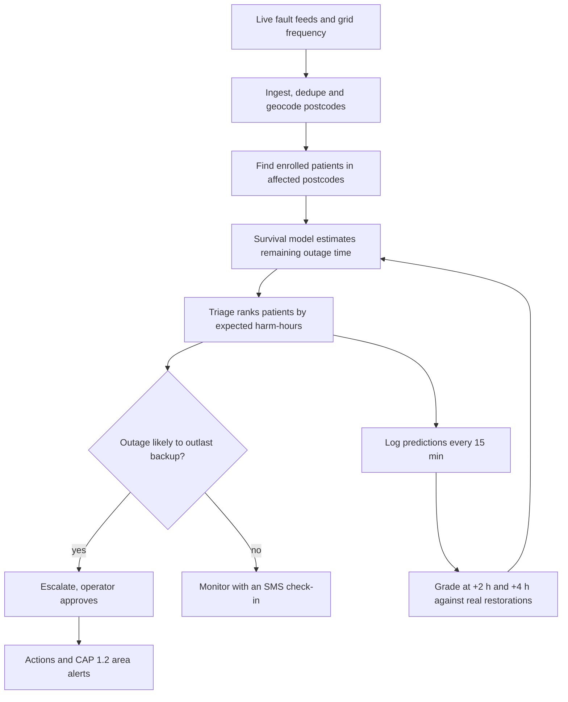
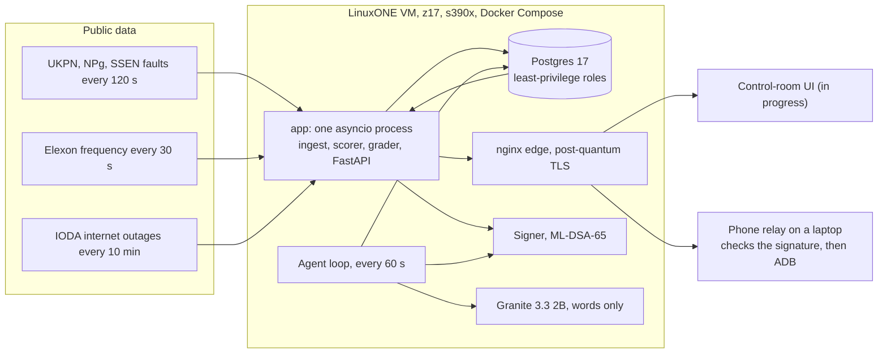

# Blacknaught

Blacknaught predicts blackouts before they happen and protects the people they'd hurt most.

It reads live grid fault feeds and home power sensors, flags where power is likely to fail, and when it does fail,
works out which electricity-dependent patients will run out of backup before the power comes back. Then it tells the
people who can help. It all runs on an IBM LinuxONE (s390x) VM.

Built in 24 hours by **The 4 Musketeers** for the IBM Z Datathon 2026 (Manchester hub). Theme 1, Real-Time AI for
Critical Decisions, with Theme 2 security built in.

## Why this exists

A static oxygen concentrator has no battery. A cylinder lasts roughly 8 to 20 hours, a modern ventilator battery about
15, an older one about 6. Outage maps say a street is off. The Priority Services Register says someone vulnerable lives
there. Nobody joins the two and asks: will this outage outlast this person's backup? After Storm Arwen some homes were
off for up to 11 days, and Ofgem found most people on the register couldn't recall being contacted.

## What it does

Two halves: predict where power will fail, then protect the people it will hurt.

| Layer | Question | Lead time | State |
|---|---|---|---|
| Area fault risk | Which districts are likely to have faults tomorrow? | Hours to days | Live climatology baseline. Weather model (M8) trained: +5.1% Brier skill on 2024–26, not wired in yet |
| Home sensors | Which homes will probably lose power in the next 30 minutes? | Minutes | Trained and tested on real Accra sensor data: top 1% of alerts come true 18.8% of the time, 8.9× the base rate. GB demo homes have no sensor feed yet |
| Grid stress | Is the whole grid in trouble? | Seconds | Live band rule on Elexon frequency. Replayed on NESO 1-s data: 74 s warning before the 9 Aug 2019 demand disconnection |
| Protect | Who runs out of backup first, and who do we call? | During the cut | Live: triage, grading, approvals, CAP alerts, "my home" |

Each layer keeps its own source and horizon. We don't blend them into one made-up percentage. For households,
`/api/me/home` is getting a headline risk level (Low / Elevated / High) with the three layer gauges underneath, each
labelled with where it came from. That part is being built now.

We don't claim to predict every blackout, and frequency only gives seconds of warning. It can't tell you where.

## How it works



Triage compares a quantile of the remaining outage time with the patient's remaining backup. How cautious it is depends
on what's at stake:

| Patient | Quantile used |
|---|---|
| No second power source and under 2 h of reserve | 90th percentile, the pessimistic one |
| Reserve more than twice the median | Median |
| Everyone else | 75th percentile |

Patients are ranked by severity, times the chance they have no other backup, times the expected hours past their
reserve. Every ranking comes with a plain-English reason. A "power back" SMS never de-escalates a patient with no
backup.

The system also grades itself. Every 15 minutes it logs, for each live outage, the chance it's still off 2 and 4 hours
later, then scores that against the operator's own restore time. A fault that just disappears from a feed is treated as
censored, not restored.

## Architecture



Some choices worth knowing:

- **One process.** Ingest, scoring, grading and the API share one asyncio loop. On 3 vCPUs and 8 GB, splitting them
  would add network hops and buy nothing. Writes are batched (250 ms or 500 rows).
- **The API can only read views.** Four Postgres login roles, each with the minimum it needs. A bug in a handler can't
  reach base tables or encrypted columns.
- **A missing record isn't a restored one.** Feeds silently drop faults. Records gone for two polls are marked
  "vanished" and graded as censored, so our scores mean something.
- **Contracts first.** `contracts/openapi.yaml`, `contracts/events.schema.json` and `contracts/model.md` were frozen
  early so four people could build in parallel.

## Platform, agent and proof

Everything runs on the LinuxONE VM (z17, s390x, 3 vCPUs, 8 GB) as one Compose project, `infra/docker-compose.yml`:
`db`, `app`, `signer`, `edge`, `agent` and `granite`. `bash infra/test-compose.sh` checks 17 boundaries in the rendered
config. For example: the signer and Granite publish no port, only the app and the agent can reach the signer, only the
agent can reach Granite, and the app answers only on the VM itself.

- **Post-quantum TLS at the edge.** nginx 1.26.3 on Debian trixie's OpenSSL 3.5.7 serves the UI and proxies `/api`
  and `/stream`. It offers the hybrid X25519MLKEM768 key exchange, with a trusted Let's Encrypt certificate for
  `148-100-78-95.sslip.io`. Checked from outside the VM: `Negotiated TLS1.3 group: X25519MLKEM768` and
  `Verify return code: 0 (ok)` (`evidence/09_edge_pq_tls.txt`).
- **ML-DSA-65 signatures.** A small signer service holds the only private key, and the key never leaves its container.
  Each caller needs its own token, and the signer sits on an internal network that only `app` and the agent join. It
  signs the audit chain's checkpoints, each approved CAP alert and every tool call the agent makes. The public key is
  `contracts/signer_pub.pem` (key_id `bda7ac1f8fd6c9d2`), so anyone with OpenSSL 3.5 can check a signature
  (`contracts/signer.md`).
- **Off-box audit checkpoints.** Every 10 minutes the laptop (`offbox/publish.py`) checks each new signed checkpoint
  against the pinned key and commits it to the `audit-checkpoints` branch on GitHub. A chain rewritten on the VM
  would no longer match the heads published there, and the VM never holds GitHub credentials.
- **The agent.** `backend/app/agent.py` runs every 60 s as its own service and database role.
  - It reads the live triage and the feeds' health.
  - It fills five responders' rounds with a greedy knapsack on harm-hours avoided per minute. Whoever runs out
    before power is likely back goes first.
  - It acts only through its tools: `assign_visit`, `notify_carer`, `request_supplier`, `escalate`,
    `draft_cap_alert`, `bulk_sms`, `mark_source_stale`, `write_sitrep`, `field_briefing` and `recalibrate`.
  - Every call is signed before it's made, so no signature means no action.
  - 999 escalations, CAP drafts and texts to more than 10 carers wait for an operator.
  - A feed with no good poll for three intervals is marked stale. Its patients are then judged on the pessimistic 90th
    percentile and re-ranked.
  - Its memory is a Postgres table, so a restart repeats nothing.
  - Every hour it checks itself against the overnight grades: a monotone correction fitted on the older GB grades is
    kept only if it lowers the Brier score on the newer ones, and it's logged with both scores. The triage scorer
    doesn't apply it yet.
- **Sensor simulator.** `backend/app/simulator.py` puts fuse-box sensors at synthetic homes, plus street anchors and
  controls, on the footprints of real live faults: about 2,200 sensors. Affected sensors send a last gasp at the fault's
  real start and stay silent until its real restoration. On top of that comes noise:
  - about 75% comms uptime;
  - some sensors fitted behind a backup;
  - partial faults where only one home in three loses power.

  Every event is labelled SIMULATED.
- **Real sensors, replayed.** `backend/app/replay.py` plays a week of real nLine GridWatch readings from 429 plug-in
  sensors in Accra (1-7 June 2021, CC BY-NC 4.0) into the same sensor path at ten times speed. Every event is
  labelled REPLAY. The data has no coordinates, so the sensors share one cell at Accra's centre.
- **Granite on the box.** IBM Granite 3.3 2B Instruct, in the big-endian Q4_K_M build, runs in its own container
  through the lab image's `llama_cpp`. It won't load unless the model file matches its pinned SHA-256. It sits on an
  internal network that only the agent joins, with no route out.
  - It only words things: the sitrep, field briefings and the CAP alert text.
  - If its text has a number that isn't in the decision's own facts, the text is rejected and the template kept.
  - Without Granite the decisions are identical (tested).
  - A fresh text takes about 80 s on the CPU, so the agent asks for one per tick.
- **Public alert, mocked.** Blacknaught drafts standard CAP 1.2 alerts that a government alerting service can
  broadcast; in the demo a phone stands in for that channel.
  - `alerting/relay.py` runs on a laptop with an Android phone on USB, and polls for operator-approved alerts.
  - It checks each alert's ML-DSA-65 signature against the pinned public key. Unsigned or tampered alerts are refused.
  - Only then does it show the alert on the phone over ADB, as an "EXERCISE" notification.
- **Evidence.**
  - `scripts/proof.sh` reruns the evidence pack into `evidence/`, including these platform checks
    (`evidence/12_platform.txt`).
  - NNPA timing on and off is in `evidence/nnpa_timing.csv`.
  - The firewall and the app image's scan are in `evidence/10_firewall.txt` and `evidence/11_trivy_app.txt`.

## Tech stack

| Layer | Choice | Why |
|---|---|---|
| Base image | IBM `jupyterlab-image-s390x` (Python 3.12, TensorFlow + zDNN, XGBoost, pandas) | IBM's compiled s390x stack, pinned so pip can't replace it |
| API | FastAPI, uvicorn, sse-starlette | Async and pure Python, so no wheel problems |
| DB driver | pg8000 | psycopg2 has no s390x wheel |
| Database | PostgreSQL 17 | Roles, views and `SECURITY DEFINER` give least privilege with no extra services |
| Crypto | AES-256-GCM via libcrypto (`ctypes`), argon2id sessions, ML-DSA-65 signer for audit checkpoints (OpenSSL 3.5) | Uses CPACF. `cryptography` isn't available on s390x |
| Edge | nginx 1.26.3 on Debian trixie, OpenSSL 3.5.7 | Offers X25519MLKEM768, the hybrid post-quantum key exchange |
| Alerts | CAP 1.2 XML, XSD-validated in tests | The OASIS standard for public warnings |
| Agent text | IBM Granite 3.3 2B Instruct (big-endian GGUF, Q4_K_M) via `llama_cpp` | IBM's own model, run on the box, with no cloud AI |
| Frontend | Vite, TypeScript, MapLibre GL (in progress) | Built on a laptop, served as static files |
| Tests | pytest, pytest-cov, httpx, xmlschema | Run on the VM against a separate test database |

## Why LinuxONE

- **We train on it.** The duration and district risk models are fitted on the VM from raw operator data downloaded
  straight onto it (`evidence/03_training.txt`, `notebooks/train_on_linuxone.ipynb`).
- **Models are big-endian safe.** XGBoost JSON and `.keras` only, never pickles, with predictions checked to match on
  s390x.
- **Encryption uses the hardware.** Patient fields are AES-256-GCM through the system libcrypto, which uses CPACF,
  tested against NIST vectors.
- **Telum's NNPA is there.** The zDNN TensorFlow plugin loads on the VM, and we time the trained Keras duration model
  with NNPA on and off (`evidence/nnpa_timing.csv`). That model isn't the live one: Kaplan–Meier scored better on UKPN
  (see Results), and it needs no accelerator.
- **Security a regulator would expect.** Least-privilege roles, a hash-chained audit log, operator login for approvals,
  a blind index for encrypted lookups, and nothing under a count of 11 shown on a map.

## Results so far

Numbers from the VM on the morning of 18 Oct 2026.

**Live grading of the Kaplan–Meier baseline** against real restorations. Lower Brier is better; always guessing 50%
scores 0.25.

| Operator | Horizon | Graded | Censored | Brier | Range if censored rows went either way |
|---|---|---|---|---|---|
| UKPN | +2 h | 283 | 3 | 0.165 | 0.165 to 0.168 |
| UKPN | +4 h | 205 | 0 | 0.156 | 0.156 |
| SSEN | +2 h | 21 | 70 | 0.099 | 0.090 to 0.410 |
| SSEN | +4 h | 10 | 64 | 0.279 | 0.229 to 0.285 |
| Northern Powergrid | both | 0 | 483 | n/a | No restore times published |

UKPN is the one to trust, because it publishes explicit restore times. These grades are for the ENWL-fitted curve
(`m1-km-enwl`). Since 06:50 the live triage uses a Kaplan–Meier curve refitted on UKPN's own outages (`m1-km-ukpn`),
and the grader scores the two side by side by model id.

**Trained duration models (M2), offline test.** Trained on the VM on ENWL 2000–22 (269,170 outages), tested on ENWL
2024–26 and on 178,864 UKPN outages none of the models saw (`ml/notebooks/m2_duration.ipynb`). Integrated Brier over the
first 24 hours; lower is better:

| Model | ENWL 2024–26 | UKPN |
|---|---|---|
| Kaplan–Meier (live today) | 0.121 | 0.138 |
| Kaplan–Meier per cause (cause isn't known live) | 0.109 | n/a |
| XGBoost AFT on live fields | 0.114 | 0.149 |
| Keras hazard MLP on live fields | 0.117 | 0.141 |

Start time, customers and voltage carry little signal. The fault's cause carries the most, and the live feeds don't
publish it. Trained on one operator, the models don't beat Kaplan–Meier on another, so they aren't live. Recalibrating
on UKPN 2021–24 didn't close the gap: on UKPN's newest year (Apr 2024–Mar 2025) the calibrated model scores 0.143 against
Kaplan–Meier's 0.131, because the live fields can't rank UKPN outages at all (C-index 0.50). What did help was refitting
Kaplan–Meier itself on UKPN 2021–24: 0.1297 on that newest year against the ENWL curve's 0.1311 (Brier at 2 h 0.249 vs
0.256). That's the curve live now.

**Weather fault risk (M8).** For each ENWL area and day, the training years' average for that month, times a weather
effect XGBoost learns from Open-Meteo history (gusts, rain, temperature, snow) at the area's centre. Trained on
2010–22, tested on 2024–26 (`ml/m8.py`, `evidence/train_log_m8.txt`). P(3 or more faults in a day): Brier 0.199 against
the baseline's 0.210, **+5.1% skill**. On Storm Éowyn (Cumbria, 24 Jan 2025, 226 faults) M8 expected 27 faults; the
baseline expected 7.6. It still under-calls the worst storms. With areas this size, 3 faults happen on 65% of days,
so the threshold should rise.

**Grid stress replay (M4).** A rule, not a trained model, with every threshold fixed in code before the replay was
scored (`ml/m4.py`, `evidence/train_log_m4.txt`). It warns when frequency is below 49.8 Hz and, at the last 5 seconds'
rate of fall, would reach 48.8 Hz (automatic demand disconnection, LFDD) within 60 s. Replayed on NESO's 1-second data:

| Signal | Warning before LFDD on 9 Aug 2019 | False alarms, Oct 2025 – Sep 2026 |
|---|---|---|
| Below 49.8 Hz (live STRESSED) | 74 s | 11.1 a month |
| Below 49.5 Hz (live EMERGENCY) | 71 s | 0 |
| M4 rule | 74 s | 0.4 a month (5 in the year) |

Honest reading: M4 gains 3 seconds over the live EMERGENCY band and costs 5 false alarms a year, so the live band rule
stays. It's one event, and those seconds exist only on 1-s data (see Limits).

**Home-sensor early warning on real data.** One week of nLine GridWatch readings from 429 sensors in Accra, Ghana
(4.76 M readings, June 2021). Trained on five days, tested on the next two. Label: did this home lose power within 30
minutes?

| Signal | ROC AUC |
|---|---|
| Learned model on the home's own sensor | 0.668. Top 1% of alerts were right 19.7% of the time, 9.3x the 2.1% base rate |
| Plus the share of the district already dark | 0.684 |
| Rule: recent flicker | 0.568 |
| Rule: low voltage | 0.514, close to a coin flip |

Supply instability and time of day carried the signal. Low voltage, which we expected to work, didn't. Full output in
`evidence/07_precursor_probe.txt`.

**The served version** (`ml/home_sensor.py`) trains on days 1–4, calibrates its probability and sets the "elevated"
threshold on day 5, and is tested on days 6–7, with a 5-run bootstrap over sensors. It flags 0.96% of home-windows, and
**18.8% ± 1.1% of those homes lose power within 30 minutes, 8.9× the 2.1% base rate** (ROC AUC 0.666 ± 0.005).
Log: `evidence/train_log_home_sensor.txt`.

198 tests pass on s390x with 96% coverage (`evidence/04_tests.txt`).

## Run it on LinuxONE

You need an s390x host with Docker and Compose.

```bash
git clone https://github.com/saliha006/BlackNaught.git && cd BlackNaught

# secrets are files, never environment variables
mkdir -m 700 secrets
for s in pg_super_pw db_migrator_pw db_ingest_pw db_api_pw db_agent_pw bidx_key dek operator_pw; do
  openssl rand -hex 32 > secrets/$s
done

# the full stack: the backend, the ML-DSA signer, the post-quantum TLS edge, the agent loop and Granite
sudo docker compose -f infra/docker-compose.yml build signer
bash scripts/make-signer-secrets.sh   # once, as a docker-group user (not sudo), so the signer can read its key
bash scripts/make-edge-cert.sh        # once: a self-signed edge certificate until a trusted one replaces it
# Granite's model lives next to the repo, in ../models; infra/granite.yml pins its SHA-256
mkdir -p ../models && curl -L -o ../models/granite-3.3-2b-instruct-be.Q4_K_M.gguf \
  https://huggingface.co/taronaeo/Granite-3.3-2B-Instruct-BE-GGUF/resolve/main/granite-3.3-2b-instruct-be.Q4_K_M.gguf
sudo docker compose -f infra/docker-compose.yml up -d --build
sudo docker compose -f infra/docker-compose.yml exec app python -m app.migrate
sudo docker compose -f infra/docker-compose.yml exec app python -m app.auth bootstrap   # operator login
sudo docker compose -f infra/docker-compose.yml exec app python -m app.seed             # synthetic patients
curl -s localhost:8000/api/health

# tests
sudo docker compose -f backend/compose.backend.yml run --rm --no-deps app pytest --cov=app

# public-alert demo, on the laptop the Android phone is plugged into (Git Bash, USB debugging on)
python alerting/relay.py   # each operator-approved CAP alert whose ML-DSA signature verifies goes to the phone
```

API docs live at `/api/docs`. The API binds to `127.0.0.1`; the public entry point is the nginx edge.
`scripts/proof.sh` reruns the whole evidence pack (platform, containers, training, tests, live service, security,
and the stack's signer, edge, agent and Granite checks) into `evidence/` without printing secrets.

Main endpoints: `/api/outages`, `/api/triage`, `/api/agent/grades`, `/api/areas/risk`, `/api/grids/{grid}/stress`,
`/api/cells`, `/api/decisions/{id}/approve`, `/api/alerts/cap/{id}`, `/api/me/home`, `/api/audit/verify`, and the
SSE stream at `/stream`.

## Data

| Dataset | Used for | Licence |
|---|---|---|
| ENWL historic unplanned outages (312,936, 2000 to 2026) | Training duration and district risk | CC BY 4.0 |
| UKPN Interruptions Incentive Scheme (316,435 rows, 180,059 incidents) | Cross-operator validation | CC BY 4.0 |
| UKPN, Northern Powergrid, SSEN live faults | Live outages and grading | CC BY 4.0, NPg Open Data Licence v1.0, public feed |
| Elexon system frequency | Grid stress | Public API |
| NESO historic system frequency (1 s; Aug 2019, Oct 2025 – Sep 2026) | Grid stress replay | NESO Open Data Licence |
| IODA (Georgia Tech) | Wide-area outage signal | Free for research |
| postcodes.io | Postcode lookups | Open Government Licence |
| nLine GridWatch Accra | Home-sensor study | CC BY-NC 4.0, GPS and IDs stripped first |
| Open-Meteo | Weather for area risk (M8) | CC BY 4.0 |

There is no real patient data anywhere. Every patient is synthetic (`backend/app/seed.py`), placed on real fault
footprints, with phone numbers from Ofcom's range reserved for drama. A table constraint refuses non-synthetic rows.

## Things that went wrong

- Northern Powergrid sends UK local time labelled as UTC, so outages looked an hour old. We parse it as UK wall-clock.
- UKPN uses `0001-01-01` to mean "not known yet". We were reading it as a restore time.
- Our first fake patients sat on days-old faults, so everyone was escalated. Now they're only seeded on faults under 6
  hours old.
- Elexon once published 182 readings of 0 Hz, which our stress rule would call an emergency. Nate caught it in the
  historical data; out-of-range readings are now dropped.

## Limits and next steps

- Patients and the GB home sensors are simulated. The faults, restore times, frequency and Accra data are real.
- The live duration model is a Kaplan–Meier curve refitted on UKPN. The trained models beat Kaplan–Meier on held-out
  ENWL outages but not on UKPN's, so they aren't live (see Results). It also scores NPg and SSEN outages, which have no
  open history of their own.
- Live area risk is still the climatology baseline and says so. The weather model (M8) beats it by 5.1% but isn't wired in.
  ENWL redrew its northern districts in 2024, so the baseline, which averages by district name, has no history for
  Penrith or Workington; M8 merges them into one Cumbria area.
- Northern Powergrid can't be graded and SSEN only partly, because grading needs explicit restore times.
- Grid stress warning is seconds, and only on 1-second data. Elexon's live feed is every 15 s and about 1.5 min late, so
  on a 9 Aug 2019-style event the live gauge turns red after the disconnection has started. The replay is one event.
- The agent's words come from Granite on the CPU. A fresh text takes about 80 s, so the agent asks for one per tick and
  keeps its template for the rest. The brief's zDNN route needs the 2.7 GB Q8_0 build; we run Q4_K_M on the CPU instead.
- NNPA is timed, not used live: the live duration model is the Kaplan–Meier curve.
- The public alert goes to a phone over ADB, standing in for a government alerting service. Nothing is broadcast to the
  public.
- The database volume isn't LUKS2-encrypted yet. The field-encryption key isn't wrapped by the signer either; it's a file
  under `secrets/`, like the other secrets.
- The evidence combiner (`backend/app/combiner.py`) fuses sensor quorum, the DNO feeds, IODA and grid stress into one
  outage probability per cell, and `evidence/localiser.json` scores it on the live footprints. Triage doesn't use it
  yet, and its likelihood ratios are hand-set, because the measured table never arrived.
- Jupyter (port 38888) is open to the internet behind its token, so the team can reach its notebooks during the event.
  Everything else public is SSH and the edge (`evidence/10_firewall.txt`). A real deployment would close it.
- The edge's Let's Encrypt certificate lasts until 16 Jan 2027 and won't renew itself, because port 80 stays closed.
- Next: a pilot with one health team and one network operator, a small real sensor fleet whose data becomes local
  outage labels, a learned combined risk score once one grid has all three data types, and audit checkpoints published
  off the box.

## Team

| Who | GitHub | Built |
|---|---|---|
| Sali | `saliha006` | Backend: ingest, schema and roles, triage, grading, audit chain, auth, SSE, map cells, CAP, "my home", encryption, the sensor probe, evidence scripts |
| Ahmed | `meep-boop` | Platform: VM and Compose stack, post-quantum edge, ML-DSA signer, agent loop, Granite, sensor simulator, Accra replay, public alert relay, IBM labs |
| Nate | `aldrichbanas07` | Data and ML: survival model, home-sensor model, weather area risk, grid stress validation, s390x ML checks |
| Rama | `rama0623` | Frontend: control-room UI, map, triage and approval views, video |

## Open source

FastAPI, Starlette, Pydantic, uvicorn, sse-starlette, pg8000 (with scramp and asn1crypto), httpx, anyio, argon2-cffi,
PyYAML, PostgreSQL, OpenSSL, Docker, nginx, TensorFlow and the IBM zDNN plugin, XGBoost, NumPy, pandas, scikit-learn,
JupyterLab, pytest, pytest-cov, coverage.py, xmlschema, Vite, TypeScript, MapLibre GL JS.

nLine GridWatch data is used under CC BY-NC 4.0, and this project is non-commercial.
